# SuperMimic on mjlab

Humanoid whole-body motion tracking with a differentiable world model, built on [mjlab](https://github.com/mujocolab/mjlab) and MuJoCo-Warp. An independent implementation of [SuperMimic](https://arxiv.org/abs/2610.28480).

## Demos

G1 policy rollouts with blue reference overlays. Selected checkpoints; [clip provenance](docs/media/manifest.json).

| Get up | Fall and recover |
| :---: | :---: |
| 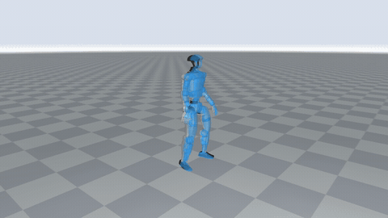 | 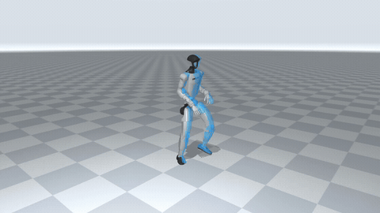 |
| **Jumps** | **Jumps · variation** |
| 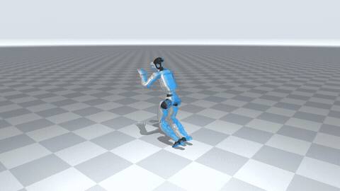 | 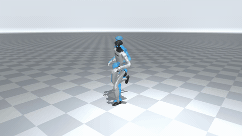 |
| **Jumping kick** | **Kung fu** |
| 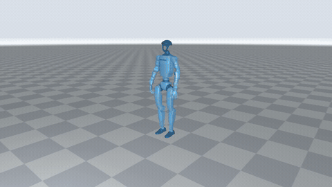 | 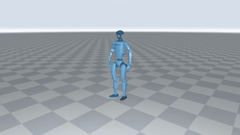 |
| **Kicks** | **Hammer fist** |
| 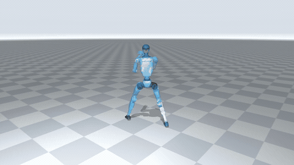 | 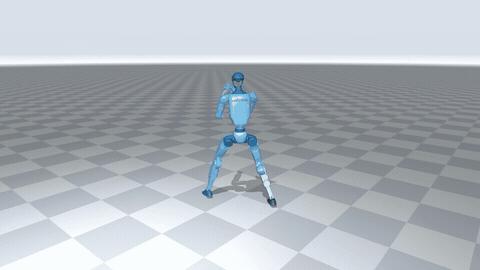 |
| **Hook kick** | **Roundhouse combination** |
| 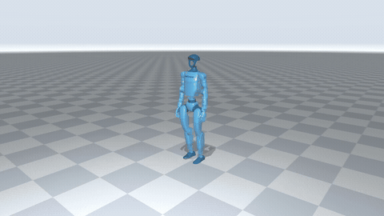 | 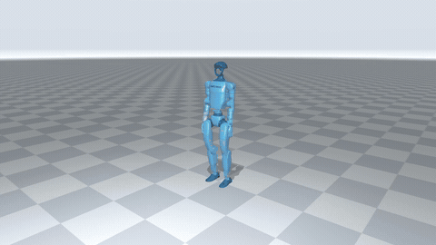 |
| **Spinning kick** | |
| 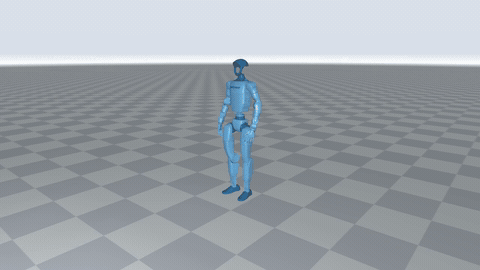 | |

## Quick start

Linux, an NVIDIA GPU with a CUDA 12.9-compatible driver, and [uv](https://docs.astral.sh/uv/).

```bash
git clone https://github.com/KunYing-Lee/SuperMimic.git
cd SuperMimic
./tools/setup.sh
CUDA_VISIBLE_DEVICES=GPU-uuid ./run_train.sh lafan1_mjlab
```

Replace `GPU-uuid` with your GPU UUID from `nvidia-smi -L`. Setup installs pinned dependencies and downloads the 40-motion LAFAN1 dataset. Run training in tmux for persistent sessions.

## Evaluate

```bash
CUDA_VISIBLE_DEVICES=GPU-uuid uv run python supermimic/evaluate.py \
  --run_dir logs/lafan1_mjlab --ckpt logs/lafan1_mjlab/ckpt_002000.pt \
  --record logs/lafan1_mjlab/traj.npz
MUJOCO_GL=egl uv run python tools/render.py logs/lafan1_mjlab/traj.npz \
  logs/lafan1_mjlab/tracking.mp4 --global_ghost
```

[Implementation details](docs/paper_alignment.md) · [Evaluation guide](docs/evaluation_comparison.md) · [Runtime benchmarks](docs/mars5090_runtime.md)

## External tasks

The installable `supermimic-mjlab` package owns G1 world-model training. LAFAN1 is the default task; use `uv sync --locked` and `uv run python -m supermimic.train`. Robot assets and motions for LAFAN1 are downloaded by `tools/setup.sh` in the editable checkout.

An external launcher pins this repository's commit and calls:

```python
from supermimic.train import main
from my_task import MyTask

main(task=MyTask())  # or main(argv, task=MyTask())
```

Implement `supermimic.task.Task` (or override `LafanTask`):

- `add_arguments(parser) -> None`: add task flags and override core defaults with `parser.set_defaults(...)`.
- `setup(args, sim_cfg) -> MDP`: build motion/MDP and configure physics after shared CUDA stream setup, before learner allocation. Set `robot_path`, `sources`, `assets`, `replay_extra`, and `fine_tune_args` here or on the task class. `name` identifies the task in saved arguments.
- `make_env(args, sim_cfg, mdp) -> TrackingSim`: construct the simulator with the existing scene/reset/label hooks.
- `sample_starts(replay, batch, hist, clip_end, horizon) -> (start, history)`: use replay's eligibility/history checks and optionally its preferred-frame sampling. `clip_end` is indexed by frame on the replay storage device.

The MDP supplies goals, rewards, extra/contact dimensions, `schedule(env_steps)` (vectorized steps, including warmup), and `imagine_termination(S, f, aux, F=()) -> (aux, cut)` for analytic imagined termination. The latter defaults to `terminate`; simulator steps always use `terminate`. Task-specific derivatives and curriculum scaling belong in those MDP overrides. Replay extras map names to `(shape, torch.dtype)`; `aux` carries imagined task state and `contact` supplies world-model targets.

Declare every external source and asset file in `sources` and `assets`, including launcher/configuration code and scene metadata. Core code, motion files/metadata and robot assets are hashed automatically. Schema-2 checkpoints and normalization buffers are unchanged; strict resume checks task files too. `--fine_tune` permits source changes and `fine_tune_args` (also newly introduced flags at parser defaults); assets and package versions remain checked. Installed wheels record Git metadata as null when no checkout is present.

Climbing is owned by `humanoid_boldering` (`hbold`), which should pin the completed core commit. Port its adapter, tools and tests from `cf1d565`; this repository has no task dependency or climb CLI flags.

## License

[MIT](LICENSE). Original implementation © 2026 ETH Zurich, Chong Zhang. LAFAN1: CC BY-NC-ND 4.0; Unitree robot assets: BSD-3-Clause. Third-party assets retain their respective licenses.
