# SuperMimic on mjlab

Humanoid whole-body motion tracking with a differentiable world model, built on [mjlab](https://github.com/mujocolab/mjlab) and MuJoCo-Warp. An independent implementation of [SuperMimic](https://arxiv.org/abs/2610.28480).

## Demos

G1 policy rollouts with blue reference overlays. Selected checkpoints; [clip provenance](docs/media/manifest.json).

| Get up | Fall and recover |
| :---: | :---: |
| 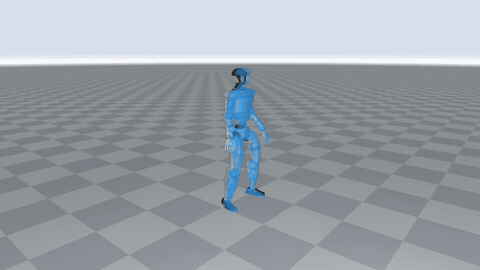 | 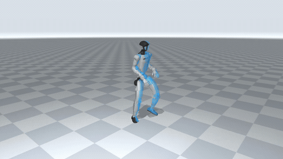 |
| **Jumps** | **Jumps · variation** |
| 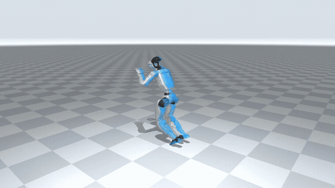 | 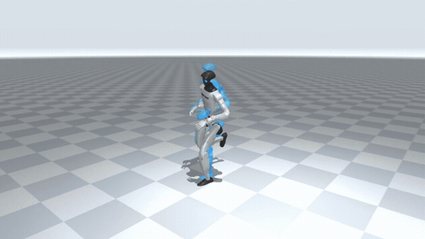 |
| **Jumping kick** | **Kung fu** |
| 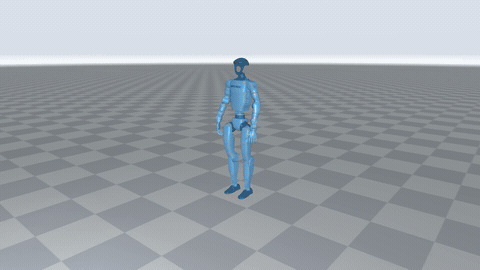 | 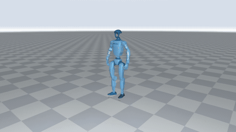 |
| **Kicks** | **Hammer fist** |
| 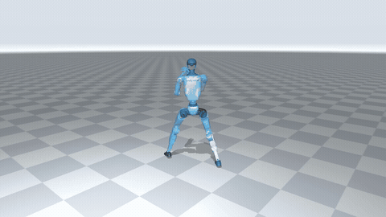 | 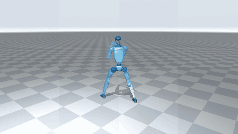 |
| **Hook kick** | **Roundhouse combination** |
| 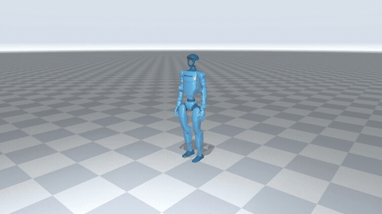 | 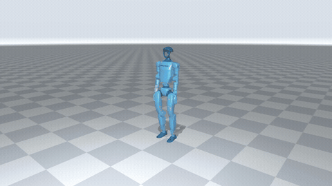 |
| **Spinning kick** | |
| 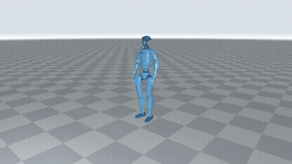 | |

## Quick start

Linux, an NVIDIA GPU with a CUDA 12.9-compatible driver, and [uv](https://docs.astral.sh/uv/).

```bash
git clone https://github.com/KunYing-Lee/SuperMimic.git
cd SuperMimic
./tools/setup.sh
CUDA_VISIBLE_DEVICES=GPU-uuid ./run_train.sh lafan1_mjlab
```

Replace `GPU-uuid` with your GPU UUID from `nvidia-smi -L`. Setup installs pinned dependencies and downloads the 40-motion LAFAN1 dataset. Run training in tmux for persistent sessions.

## Evaluate

```bash
CUDA_VISIBLE_DEVICES=GPU-uuid uv run python supermimic/evaluate.py \
  --run_dir logs/lafan1_mjlab --ckpt logs/lafan1_mjlab/ckpt_002000.pt \
  --record logs/lafan1_mjlab/traj.npz
MUJOCO_GL=egl uv run python tools/render.py logs/lafan1_mjlab/traj.npz \
  logs/lafan1_mjlab/tracking.mp4 --global_ghost
```

[Implementation details](docs/paper_alignment.md) · [Evaluation guide](docs/evaluation_comparison.md) · [Runtime benchmarks](docs/mars5090_runtime.md)

## License

[MIT](LICENSE). Original implementation © 2026 ETH Zurich, Chong Zhang. LAFAN1: CC BY-NC-ND 4.0; Unitree robot assets: BSD-3-Clause. Third-party assets retain their respective licenses.
